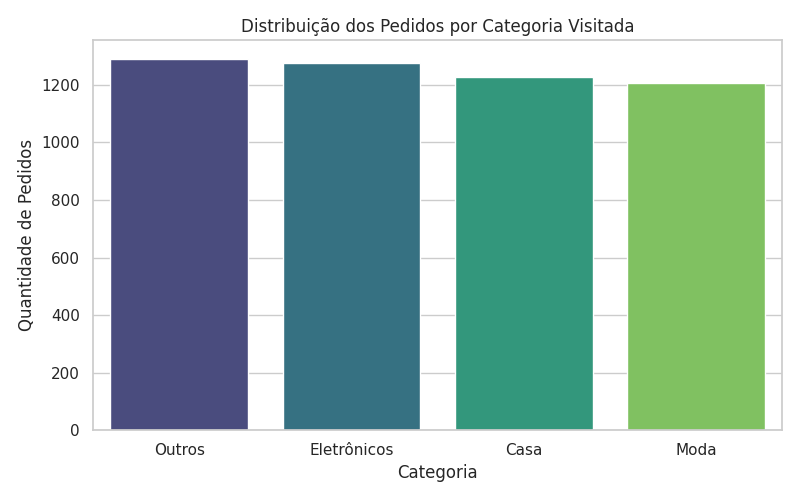
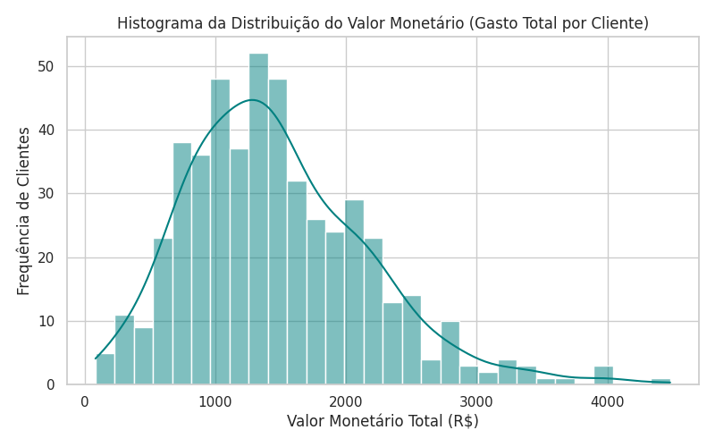
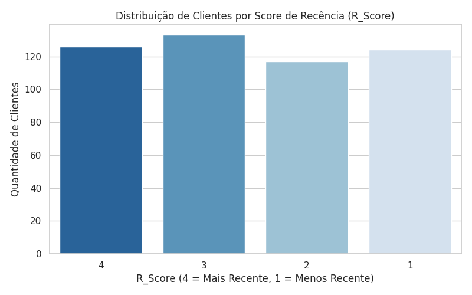
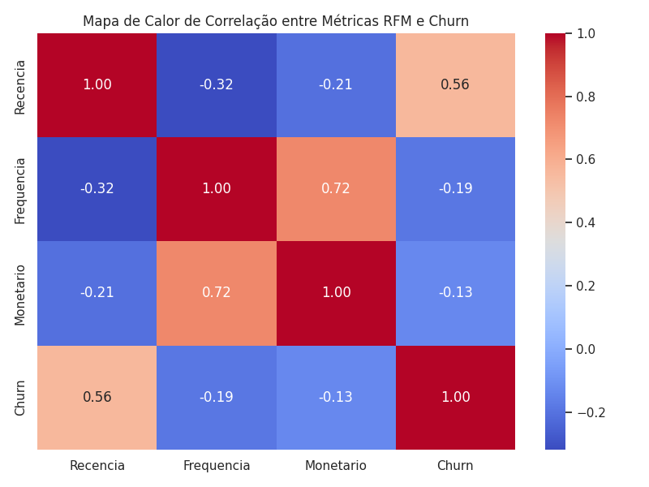
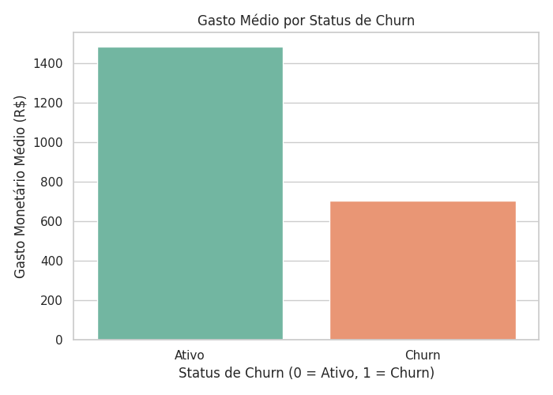

# 📊 Análise de Segmentação RFM e Diagnóstico de Churn

Este repositório contém uma Análise Exploratória de Dados (EDA) detalhada, combinada com a metodologia de segmentação RFM (Recência, Frequência e Valor Monetário) e testes estatísticos de hipóteses em Python. O objetivo principal é entender o comportamento de compra dos clientes de um e-commerce e identificar fatores associados ao Churn (Inatividade).

##  Contexto e Objetivos do Negócio

Em operações de e-commerce, reter clientes ativos é significativamente mais barato do que adquirir novos. Para atuar de forma preventiva contra o cancelamento, este projeto responde a duas perguntas centrais:

1. **Como os clientes estão distribuídos em relação ao tempo da última compra, frequência de transações e valor gasto?**
2. **Existe uma diferença estatisticamente comprovada entre o valor gasto por clientes ativos e clientes que abandonaram a marca?**

##  Tecnologias e Bibliotecas

- **Linguagem:** Python 3.10+
- **Manipulação e Estruturação de Dados:** `pandas`, `numpy`
- **Estatística Inferencial:** `scipy.stats`
- **Visualização de Dados:** `seaborn`, `matplotlib`
- **Ambiente de Execução:** Google Colab

##  Metodologia Passo a Passo

### 1. Tratamento e Inspeção da Base de Dados
A base inicial simula 5.000 transações de compras. As etapas de preparação incluíram:
- Tratamento de valores ausentes na variável de categorias (preenchidos como `'Outros'`).
- Garantia de consistência nos valores monetários transacionados (`.abs()`).
- Inspeção de tipos de dados (`.info()`) e estatística descritiva (`.describe()`).

### 2. Engenharia de Métricas RFM
Os dados transacionais foram agrupados por cliente (`ID_Cliente`) para calcular as três dimensões clássicas do modelo RFM:
- **Recência ($R$):** Quantidade de dias desde a última compra em relação à data focal.
- **Frequência ($F$):** Total de pedidos realizados pelo cliente.
- **Monetário ($M$):** Soma de todo o valor financeiro gasto pelo cliente.

Os clientes foram divididos em **quartis (Scores de 1 a 4)** para cada dimensão:
- **R_Score:** Nota 4 para menor recência (compro há pouco tempo).
- **F_Score:** Nota 4 para maior frequência.
- **M_Score:** Nota 4 para maior volume financeiro.

### 3. Definição da Regra de Negócio para Churn
Foi definida uma regra clara de inatividade:
- **Churn = 1:** Clientes com recência superior a 90 dias sem realizar compras.
- **Churn = 0:** Clientes ativos (compra nos últimos 90 dias).

##  Análise Exploratória e Visualizações

### 1. Distribuição de Pedidos por Categoria
Análise da preferência de navegação entre as categorias disponíveis no e-commerce:

### 2. Distribuição do Valor Monetário Acumulado
Visualização da assimetria do valor gasto total por cliente através de um histograma com estimativa de densidade de kernel (KDE):

### 3. Distribuição dos Clientes no Score de Recência (R_Score)
Mapeamento do volume de clientes em cada nota de recência (onde a nota 4 representa os clientes mais engajados recentemente):

### 4. Matriz de Correlação entre Métricas e Churn
Grau de associação linear entre as variáveis operacionais e a taxa de inatividade:

### 5. Comparativo de Ticket Médio: Ativos vs. Churn
Comparação visual entre o gasto acumulado de clientes ativos e clientes em churn:

##  Teste de Hipótese Estatístico (Welch's T-Test)

Para comprovar se a variação no valor gasto entre clientes em Churn e Ativos é estatisticamente significante (e não fruto do acaso), aplicamos o Teste T para amostras independentes com variâncias desiguais (Welch):

- **Hipótese Nula ($H_0$):** $ \mu_{\text{gasto\_churn}} = \mu_{\text{gasto\_ativo}} $ (O gasto médio entre os dois grupos é igual).
- **Hipótese Alternativa ($H_1$):** $ \mu_{\text{gasto\_churn}} \neq \mu_{\text{gasto\_ativo}} $ (Há diferença significativa no gasto médio entre os dois grupos).
- **Nível de Significância ($\alpha$):** 0.05 (5%)

### Conclusão Estatística:
Com o valor extraído no teste ($p\text{-valor} < 0.05$), rejeitamos a Hipótese Nula ($H_0$). Isso confirma estatisticamente que o volume de consumo de um cliente possui relação direta com o seu status de retenção, servindo como uma variável relevante para modelos preditivos de prevenção de perda de clientes.

## 📂 Como Executar este Projeto

1. Abra o arquivo [`analise_rfm_churn.ipynb`](./analise_rfm_churn.ipynb) diretamente no Google Colab clicando no selo "Open in Colab" no topo do arquivo.
2. Execute as células de código sequencialmente (`Shift + Enter`).
3. As estatísticas e gráficos serão gerados interativamente no ambiente.
